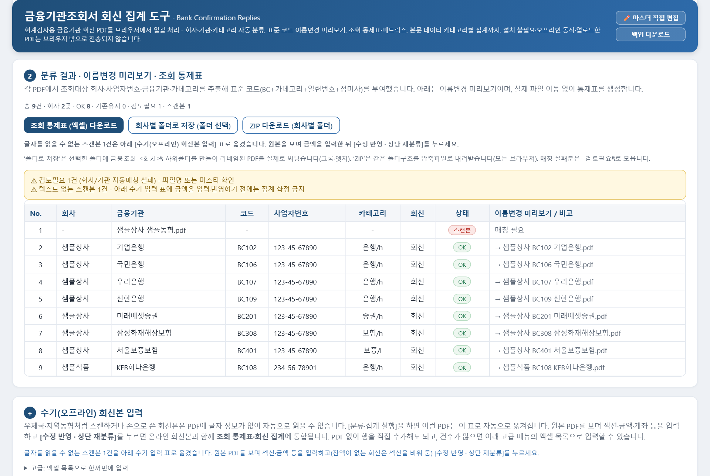
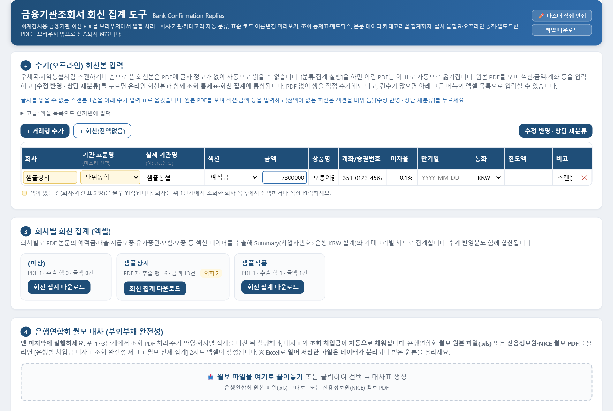
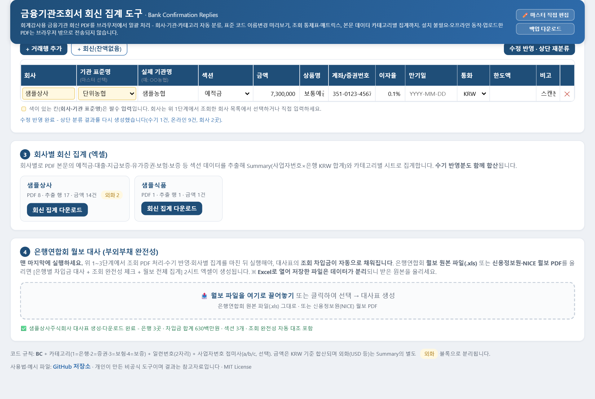
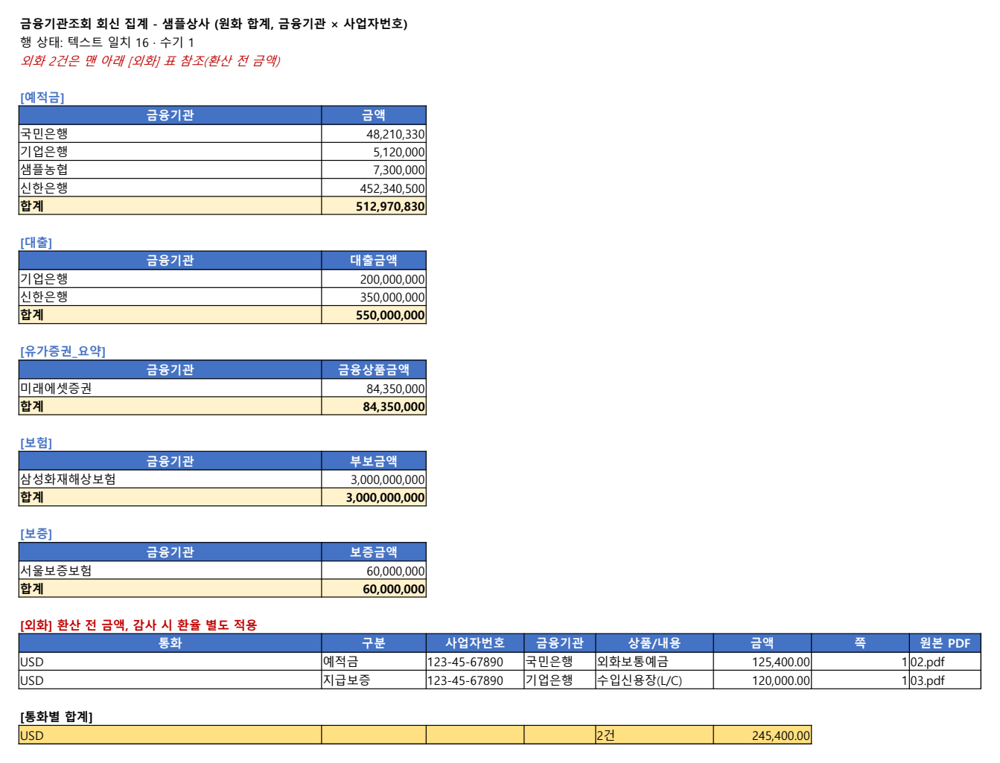
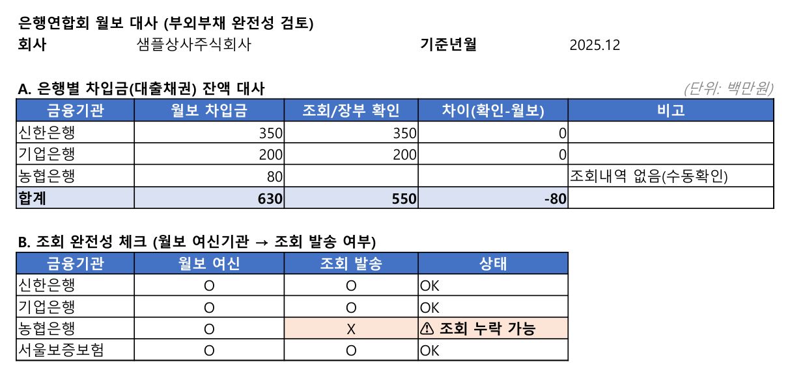

# 금융기관조회서 회신 집계 도구

회계감사 때 받은 **금융기관 조회서 회신 PDF**를 한꺼번에 넣으면 회사·금융기관별로 자동 분류하고, 예금·대출·지급보증 같은 회신 내역을 **엑셀로 집계**하는 무료 도구입니다. 브라우저에서 바로 동작해 설치가 필요 없고, 넣은 파일은 서버로 보내지 않습니다.

## 👉 바로 쓰기

**https://henmoogi.github.io/bank-confirmation-tool/**

주소를 열고 회신 PDF(또는 회신 폴더)를 화면에 끌어다 놓은 뒤 [**분류·집계 실행**]을 누르면 됩니다(크롬·엣지 권장).

인터넷이 막힌 PC에서 쓰려면 이 페이지 위쪽 초록색 **Code** 단추에서 **Download ZIP**을 눌러 받아 옮기고, 압축을 푼 뒤 `index.html`을 더블클릭하세요. 같은 화면이 열립니다.

## 파일이 어디로도 전송되지 않습니다

조회서 회신에는 회사의 계좌와 잔액이 들어 있어서, 이 도구는 **넣은 파일을 서버로 보내지 않습니다.** 브라우저 안에서만 읽고 계산합니다.

- 페이지 전체가 HTML 파일 하나이고, 외부 서버와 통신하는 코드가 없습니다(개발자용: 앱 코드에 `fetch`·`XMLHttpRequest` 호출 없음). PDF를 읽는 내장 라이브러리(PDF.js)도 통신 기능 없이 씁니다.
- 직접 시험해 보니 페이지를 연 뒤 PDF 9건 처리부터 엑셀 내려받기, 월보 대사까지 하는 동안 외부로 나간 요청이 한 건도 없었습니다.
- 웹 주소로 열어도 페이지만 받아 오고 이후 통신이 없습니다. 소스는 이 저장소의 [`index.html`](index.html)에서 직접 확인할 수 있습니다.

## 할 수 있는 일

- **자동 분류**: 회신 PDF 여러 개나 폴더(하위 폴더 포함)를 끌어다 놓으면 조회 대상 회사·사업자번호·금융기관·종류(은행·증권·보험·보증)를 PDF 안의 글로 알아냅니다. 온라인 회신은 파일 이름이 무엇이든 상관없습니다.
- **이름 정리**: 기관마다 표준 코드를 붙여 `샘플상사 BC109 신한은행.pdf`처럼 이름을 바꾼 미리보기를 보여 줍니다. 코드는 `BC` + 종류 번호 + 일련번호이고, 같은 기관 회신이 사업자번호별로 여러 장이면 끝에 a·b·c를 붙입니다. 결과는 회사별 폴더로 묶은 ZIP으로 받거나 고른 폴더에 바로 저장합니다(폴더 저장은 크롬·엣지에서 웹 주소로 열었을 때 됩니다. 더블클릭으로 열면 막힐 수 있고 블로그 글 안에서는 되지 않으니, 그때는 ZIP을 쓰세요).
- **조회 통제표**: 회사·기관별 발송 형태와 회신 현황, 금융기관 × 회사 교차표를 엑셀로 만듭니다.
- **회신 집계**: 회사마다 엑셀을 하나씩 만듭니다. 기관별 원화 합계(Summary), 예적금·대출·지급보증·유가증권·보험·보증·담보자산 시트, 종류별 집계 시트, 표를 읽지 못했거나 잔액이 없는 회신을 모은 검토필요 시트, 파일 이름·기관·양식이 서로 맞는지 보는 코드일관성검증 시트가 들어갑니다.
- **스캔·손글씨 회신**: 글자 정보가 없는 PDF는 자동으로 **수기 입력 표**로 옮겨집니다. 원본을 보며 금액·계좌를 입력하면 온라인 회신과 같은 집계에 합쳐집니다. 건수가 많으면 엑셀 목록으로 내려받아 채운 뒤 한 번에 넣을 수도 있습니다.
- **은행연합회 월보 대사**: 월보 원본(.xls)이나 신용정보원·NICE 월보 PDF를 넣으면 은행별 차입금을 월보와 조회 회신으로 나란히 맞춘 대사표를 엑셀로 만듭니다(단위 백만 원). 월보에는 있는데 회신이 없는 기관은 '조회 누락 가능'으로 표시합니다.
- **금융기관 마스터**: 86개 항목이 들어 있습니다(우체국·지역농협·새마을금고처럼 수기로 조회하는 곳의 묶음 항목 포함). 화면에서 직접 추가·수정하거나, 금융결제원 감사지원 사이트의 '온라인 발급가능 금융기관' 목록 파일을 넣어 새 기관을 찾아 넣을 수 있습니다.

| 스캔본 수기 입력 | 회사별 집계와 월보 대사 |
|---|---|
|  |  |

| 회신 집계 Summary 시트 | 월보 대사 시트 |
|---|---|
|  |  |

## 예시로 해 보기

[예시](예시/) 폴더에 가상의 회사 **샘플상사**(회신 8건)와 **샘플식품**(1건)의 조회서 회신이 들어 있습니다. 회사·사업자번호·계좌·금액은 모두 지어낸 값이고, 표 구조만 금융결제원 온라인 회신 양식을 흉내 냈습니다. 한 번에 받으려면 [`예시파일_모음.zip`](예시/예시파일_모음.zip)을 내려받으세요.

1. `01.pdf`~`08.pdf`와 `샘플상사 샘플농협.pdf`(스캔본 흉내)를 화면에 끌어다 놓고 [**분류·집계 실행**]을 누릅니다. 9건, 회사 2곳으로 분류되고 스캔본 1건은 수기 입력 표로 옮겨집니다. 스캔본은 아직 회사를 모르는 상태라 이 단계에서는 검토필요 1건과 '(미상)' 카드가 함께 보이며, 2번을 마치면 사라집니다.
2. 수기 입력 표의 샘플농협 행에 섹션 **예적금**, 금액 **7,300,000**을 넣고 [**수정 반영 · 상단 재분류**]를 누릅니다. 원본과 대조했는지 묻는 확인 창이 뜨면 '확인'을 누릅니다.
3. [**조회 통제표 (엑셀) 다운로드**]와 회사별 [**회신 집계 다운로드**]로 결과 엑셀을 받습니다.
4. 맨 아래 4번 칸에 `[월보] …_20251201.xls`를 넣습니다. 신한은행·기업은행 차입금은 조회 회신과 일치하고, 월보에만 있는 농협은행은 '**조회 누락 가능**'으로 표시됩니다.

## 알아 둘 점

- **금융결제원 온라인 회신 양식**(표에 괘선이 있는 PDF)을 기준으로 만들었습니다. 기관이 따로 만든 양식은 표를 읽지 못할 수 있습니다. 그런 회신은 검토필요 시트에 모이니, 금액은 수기 입력 표에 [+ 거래행 추가]로 직접 넣으세요(이때 조회 통제표에 같은 기관이 두 줄로 보일 수 있습니다).
- 글자 인식(OCR)은 하지 않습니다. 스캔·손글씨 회신의 금액은 사람이 원본을 보고 입력합니다.
- 금액은 원화 기준으로 합산합니다. 외화는 환산하지 않고 Summary의 외화 블록에 원래 통화로 따로 보여 줍니다. 보험 시트의 금액은 부보금액입니다.
- 월보 대사는 화면에 넣은 회신 전체와 맞춥니다. 여러 회사를 함께 넣었다면 월보 대사는 회사 한 곳씩 따로 넣어서 하세요.
- 월보 .xls를 엑셀로 열어 다시 저장한 파일은 읽지 못합니다. 받은 원본을 그대로 넣으세요.
- 마스터를 고친 내용은 창을 닫으면 사라집니다. [**백업 다운로드**]로 받은 `bank_master.xlsx`를 다음에 금융기관 마스터 칸에 끌어다 놓으면 그대로 바뀝니다.
- 원본 PDF는 바꾸지 않습니다. 이름 변경은 미리보기와 ZIP·폴더 저장본에만 적용됩니다.
- 휴대폰에서도 열리지만 표가 넓어서 PC 화면을 권합니다.

## 면책

개인이 만든 **비공식** 도구로 금융결제원·은행연합회·한국신용정보원과 관계가 없습니다. 결과는 참고자료이며 정확성·완전성을 보증하지 않습니다. 집계 결과는 반드시 원본 회신서와 대조하고, 조회 절차와 감사 판단은 사용하는 분이 직접 하셔야 합니다.

## 라이선스

- 이 도구: [MIT License](LICENSE)
- 내장 라이브러리: PDF.js 3.11.174 (Apache License 2.0), xlsx-js-style 1.2.0 (SheetJS 0.18.5 기반, Apache License 2.0), fflate (MIT)
- 자세한 고지: [THIRD_PARTY_NOTICES.txt](THIRD_PARTY_NOTICES.txt)
